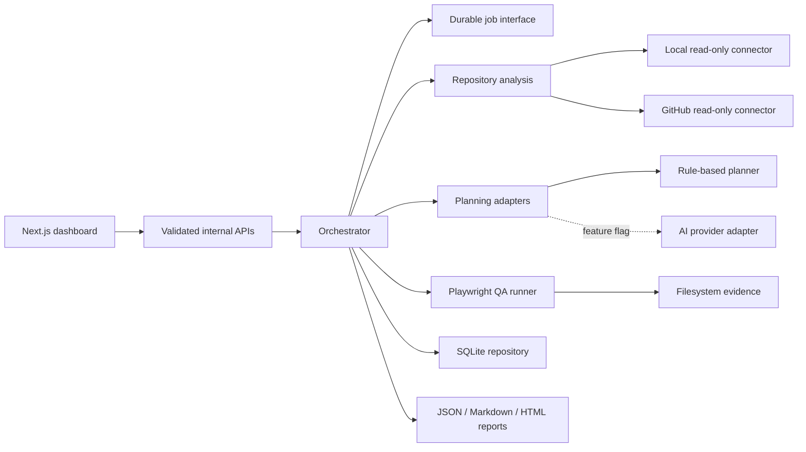
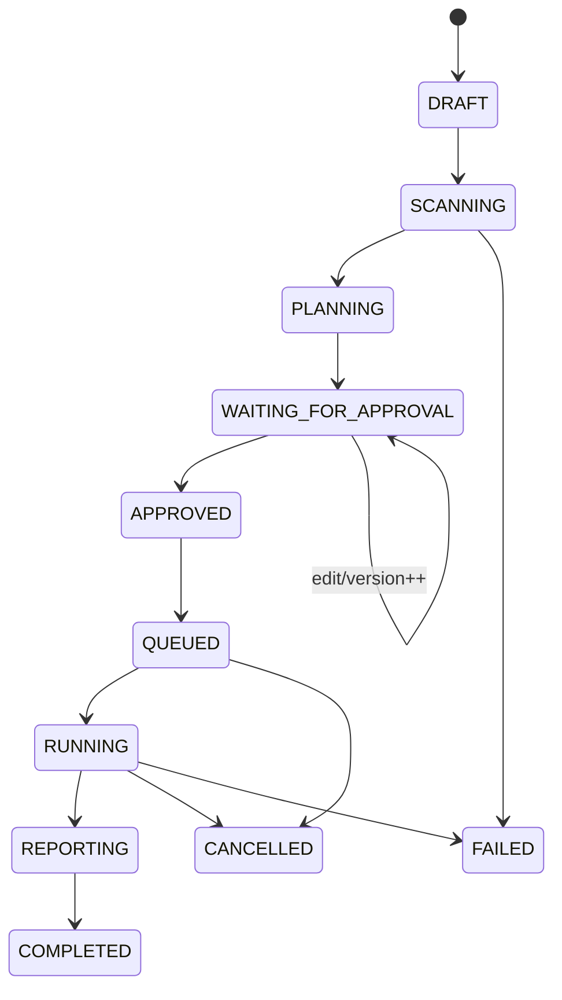

# Architecture

## Components

`apps/web` owns presentation and HTTP translation. `apps/demo-target` is isolated. Generic contracts and services live in `packages/` and contain no KOG business logic.

## Contracts and responsibilities

- `schemas`: versioned Zod wire/storage contracts and action allowlist.
- `security`: URL/host policy, canonical repository path restrictions, redaction, safe filenames.
- `repository-connectors`: bounded local and GitHub read-only snapshots.
- `repository-analysis`: deterministic framework/scripts/routes/components/tests/change/risk facts with line evidence.
- `test-planning`: provider-neutral interface, mandatory rule-based parser, merge/evidence/suggestion logic.
- `orchestrator`: workflow selection, plan versions, approvals, jobs, runs, reruns, cancellation, audit.
- `qa-runner`: semantic locator resolution, assertions, retry/timeouts, deterministic statuses, evidence.
- `persistence`: SQLite migrations and replaceable repository API.
- `evidence` / `reporting`: filesystem metadata, safe artifacts, accounting, time estimates.

## State model

An approval names `planId`, `planVersion`, item IDs, actor, timestamp, and extra staging approvals. Execution looks up the exact pair.

## Repository analysis flow

The connector canonicalises a permitted source, gathers fixed Git metadata, reads only bounded allowlisted text files, and returns a snapshot. The analyser treats all contents as untrusted data, extracts facts deterministically, and calculates a cache key from the source, refs, commit, dirty state, bounded file paths, and file contents. A modified working tree therefore cannot reuse facts from stale content. No target command or source instruction is executed.

## Execution flow

The runner receives only schema-valid approved items. It resolves semantic locators at runtime, enforces base origin, makes each active action cancellable, and classifies outcomes from Playwright assertions. Successful and ordinary failed runs retain traces, screenshots, and browser logs. Cases containing redacted input suppress browser-derived artifacts because page or trace state could contain the sensitive value. An LLM has no result-classification role.

## Scaling path

`JobQueue` is an interface boundary around in-process execution. A later operational review may replace it with a durable queue and workers; SQLite may become a managed relational store; filesystem evidence may move to object storage. Schema, runner, and approval contracts remain stable. Multi-tenancy, RBAC, sandboxed repository workers, secret brokerage, and observability are prerequisites for broader production use.
