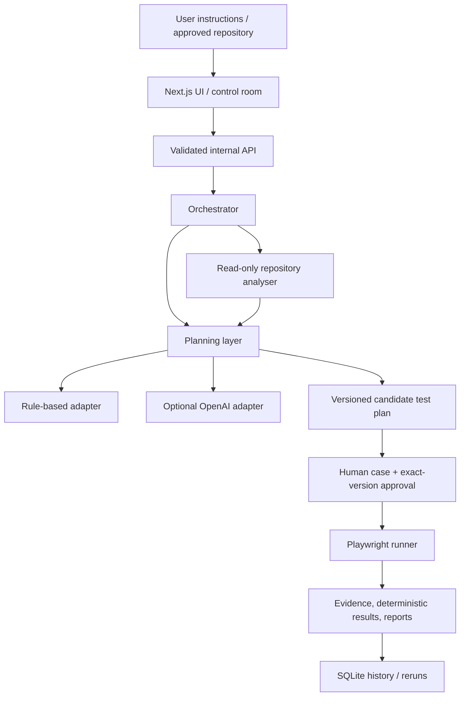

# QA Agent Platform — Department Head Brief

> Historical Stage 2 brief, retained for continuity. Its “remaining work” and verification counts describe the pre-pilot snapshot and are superseded by [QA-AGENT-CONSOLIDATED-REPORT.md](./QA-AGENT-CONSOLIDATED-REPORT.md), which records the completed authentication/configuration wiring, four workflow runs, KOG demo fallback, and current blockers.

## 1. Executive Summary

The QA Agent Platform is an internal frontend-testing proof of concept that converts manual QA instructions and read-only repository evidence into reviewable, versioned test plans. After human approval, it runs only allowlisted Playwright browser actions and produces deterministic results with evidence and reports.

It addresses three recurring problems:

- manual test intent is difficult to repeat consistently;
- repository context and existing cases are often reviewed separately;
- automation results are hard to trust without approval history and evidence.

The generic platform and the OpenAI planning adapter are implemented, tested, packaged, committed, and pushed. The deterministic no-AI path is complete. The AI path has strict structured-output and fallback tests, but it has not made a live provider call because the organisation-approved plan, model, and API key are still pending.

AI is optional. It proposes candidate cases and gaps; it does not approve plans, operate Playwright directly, or decide PASS/FAIL. Rule-based planning works without any AI credentials, and Playwright remains the execution and assertion authority.

There is no blocker to running the local demo or the no-AI platform. Before a KOG staging pilot, approved repository and staging access must be configured, and the existing authentication-adapter boundary must be wired into the orchestrator. Production use is a separate hardening phase, not the next pilot step.

## 2. Current Status

| Stage                          | Status              | Branch                               | Commit                                     |
| ------------------------------ | ------------------- | ------------------------------------ | ------------------------------------------ |
| Stage 1 — generic QA platform  | Complete and pushed | `codex/qa-platform-vertical-slice`   | `6f1512855d478d808c262da96ff8df1d4871dbaf` |
| Stage 2 — AI-assisted planning | Complete and pushed | `codex/ai-test-planning-integration` | `d392930d55cac981b9e9dbec025f12049cb75e5f` |

Completed verification:

- clean dependency installation and database initialisation;
- lint and TypeScript checks;
- 23 unit tests on the Stage 2 branch;
- 7 integration tests;
- 7 browser end-to-end tests;
- Next.js production builds;
- Docker Compose configuration and image builds;
- container health, readiness, UI, persistence, and read-only repository-mount smoke checks;
- staged-secret and generated-artifact checks.

Not yet live-tested:

- an actual OpenAI API request using the organisation-approved account, key, and model;
- the full AI-assisted browser workflow after that live request;
- a real KOG repository scan;
- authenticated KOG staging execution;
- any production deployment.

## 3. What Is Implemented

### Planning and repository input

- Manual and chat-style numbered test instructions.
- Existing-case import with each supplied case retained.
- Read-only local repository scanning beneath configured allowed roots.
- Feature-flagged read-only GitHub repository analysis.
- Detection of frameworks, package scripts, routes, components, existing tests, changed files, and risk areas.
- Repository evidence with file paths, line numbers where available, and rationale.
- Content-aware scan caching that does not reuse stale facts from a modified working tree.
- Deterministic repository-derived candidates and separate gap suggestions.
- OpenAI-assisted structured candidate generation through a provider-neutral interface.
- Automatic rule-based fallback when AI is disabled, misconfigured, or unavailable.

### Review and control

- Zod validation at API, plan, action, result, evidence, and report boundaries.
- Per-case approve/reject decisions.
- Exact-plan-version approval.
- Additional approval for staging test-data cases.
- Automatic approval invalidation and plan-version increment after an edit.
- Inline editing of title, route, and expected result.
- Duplicate indication and validation warnings.
- Candidate plans are unapproved by default, including AI suggestions.

### Execution and evidence

- Playwright execution using an explicit action allowlist.
- Semantic locators such as role, label, text, test ID, and placeholder.
- Navigation, visibility, text, URL, field-state, and validation assertions.
- Per-action timeouts, bounded retries, total-run timeout, and safe cancellation.
- Same-origin enforcement and target-host allowlisting.
- Deterministic PASS/FAIL from Playwright assertions only.
- BLOCKED, WARNING, NEEDS_HUMAN_REVIEW, and NOT_EXECUTED outcomes where appropriate.
- Screenshots, Playwright traces, and bounded/redacted browser logs.
- Browser artifacts are suppressed when a case enters redacted values.

### Reporting and operations

- JSON, Markdown, and HTML reports.
- Plan/accounting totals and clearly labelled time-saved estimates.
- Full reruns and failed-case reruns with lineage.
- SQLite persistence for requests, scans, plans, approvals, runs, and audit records.
- Filesystem evidence and report storage.
- Health and database-readiness endpoints.
- Docker packaging using a non-root Playwright image user.
- An isolated local demo application with login validation and protected routes.

## 4. Architecture



1. **UI / control room** — collects the target URL, objective, optional repository, and existing cases; displays planning, approval, progress, results, and history.
2. **API layer** — validates JSON inputs and translates HTTP requests into orchestrator operations.
3. **Orchestrator** — coordinates scans, planning, approvals, execution, cancellation, reruns, audit events, and persistence.
4. **Repository analyser** — inspects bounded, allowlisted source text and fixed read-only Git metadata. It never executes package scripts or repository instructions.
5. **Test-planning layer** — turns user intent and repository facts into schema-valid cases, duplicates, evidence mappings, and separate suggestions.
6. **AI-provider adapter** — optionally asks OpenAI for strict structured candidates. Untrusted repository facts are bounded, redacted, and labelled as data.
7. **Approval and versioning** — requires human case decisions and approval of an exact plan version. An edit invalidates approval.
8. **Playwright runner** — executes only approved, allowlisted browser actions and assertions.
9. **Evidence/reporting** — stores safe evidence metadata and produces JSON, Markdown, and HTML reports.
10. **Persistence** — stores local single-instance state in SQLite; artifacts remain on the filesystem.

AI does not execute tests and does not determine PASS/FAIL. It can only propose data that must pass schema validation and human review.

## 5. Technology Used

| Technology       | Use                                                                          |
| ---------------- | ---------------------------------------------------------------------------- |
| TypeScript       | Typed contracts and implementation across the monorepo                       |
| Node.js          | Server, orchestration, SQLite API, scripts, and test runtime                 |
| Next.js          | Web UI, internal API routes, and demo application                            |
| React            | Control-room and demo user interfaces                                        |
| Playwright       | Browser execution, assertions, screenshots, and traces                       |
| Zod              | Runtime validation for configuration and all major data contracts            |
| SQLite           | Local durable metadata and history                                           |
| pnpm             | Locked monorepo dependency management                                        |
| Vitest           | Unit and integration tests                                                   |
| Docker / Compose | Reproducible local packaging and service startup                             |
| OpenAI Node SDK  | First functional implementation of the provider-neutral AI-planning boundary |

## 6. End-to-End Workflow

### Workflow A — URL plus existing test cases

- **Input:** target URL, objective, and existing cases; no repository is required.
- **Planning:** supplied cases are parsed into structured candidate items. With AI enabled, AI-derived gaps remain separate suggestions.
- **Review:** the user checks steps, expected results, warnings, and side-effect levels.
- **Approval:** cases are approved individually, followed by exact-plan-version approval.
- **Execution:** Playwright runs only the approved items.
- **Report:** evidence, results, accounting, duration, estimated savings, and rerun controls are retained.

### Workflow B — Repository only

- **Input:** approved local or GitHub repository, target URL, and objective.
- **Planning:** bounded read-only analysis produces repository facts and candidates. AI may add structured candidates when enabled.
- **Review:** evidence, uncertainty, and unresolved selector intent are shown before approval.
- **Approval:** only reviewed cases and the exact version can proceed.
- **Execution:** Playwright runs against the allowlisted target, never against repository code.
- **Report:** repository identity/commit, results, and evidence are included.

### Workflow C — Repository plus existing test cases

- **Input:** repository, target URL, objective, and existing cases.
- **Planning:** every user case remains in the main plan; repository evidence is mapped; duplicates are marked; additional repository/AI gaps stay separate.
- **Review:** the user compares retained cases with proposed gaps and edits deterministic details if necessary.
- **Approval:** main-plan cases and the exact version require approval.
- **Execution:** only approved cases execute.
- **Report:** case provenance, repository identity, results, and evidence are retained.

### Workflow D — No existing cases

- **Input:** objective and target URL, optionally with repository facts.
- **Planning:** rule-based planning works without AI; when AI is enabled, it can generate schema-valid read-only candidates.
- **Review:** candidates begin unapproved and may carry human-review warnings.
- **Approval:** the same per-case and exact-version controls apply.
- **Execution:** Playwright performs only allowlisted actions.
- **Report:** the normal evidence, result, estimate, history, and rerun outputs apply.

## 7. How to Use the Platform

### Prerequisites

- Node.js 22.5 or newer.
- Corepack.
- A Playwright-compatible Chromium installation.
- Docker and Docker Compose only if using containers.

### Install and initialise

```bash
corepack pnpm install --frozen-lockfile
corepack pnpm exec playwright install chromium
cp .env.example .env.local
corepack pnpm db:init
```

Do not place real secrets in committed files. Populate local runtime values through the ignored `.env.local` file or an approved runtime secret mechanism.

### Start locally

Terminal 1:

```bash
QA_ALLOWED_TARGET_HOSTS=localhost,127.0.0.1 corepack pnpm dev:web
```

Terminal 2:

```bash
corepack pnpm dev:demo
```

Open `http://localhost:3000`; the included demo target is `http://localhost:3100`.

### Run a QA workflow

1. Enter the application name, target URL, environment, and objective.
2. Choose no repository, an approved local repository, or feature-flagged GitHub input.
3. Paste existing cases or chat-style numbered instructions.
4. Create or scan to generate the candidate plan.
5. Review sources, evidence, warnings, routes, steps, and expected results.
6. Edit where necessary; edits invalidate previous approval.
7. Approve the selected cases and then approve the exact plan version.
8. Queue execution and monitor progress.
9. Inspect results and reports under `var/reports/<run-id>/`.
10. Use full rerun or failed-case rerun from history.

## 8. How AI Integration Works

- `PlanningAdapter` is provider-neutral; rule-based planning and OpenAI implement the same case-generation contract.
- AI execution is disabled by default.
- OpenAI requires `AI_TEST_PLANNING_ENABLED=true`, `AI_PROVIDER=openai`, an explicit `AI_MODEL`, and a server-side `OPENAI_API_KEY`.
- The model is configurable and not hardcoded.
- Inputs are bounded by configured file and byte limits.
- Repository facts are treated as untrusted evidence, not operational instructions.
- Credential-like data is redacted or excluded before provider input and persisted output.
- The SDK requests strict structured output.
- Zod validates the parsed response and each resulting action and test-plan item.
- AI-generated items use `AI_SUGGESTED`, remain unapproved, and cannot self-approve.
- Existing user cases are parsed independently and remain unchanged in the main plan; AI gaps remain separate suggestions.
- Missing credentials, unsupported configuration, malformed output, or provider failure produces a visible rule-based fallback.
- Playwright remains the sole PASS/FAIL authority.

The adapter and failure paths are mock-tested. The organisation will provide the approved AI plan, model, and key; one controlled live validation remains pending. No key creation or billing work is part of this project.

## 9. Security and Safety Model

- Local repositories must resolve beneath explicit `QA_ALLOWED_REPOSITORY_ROOTS`.
- Recommended container access uses read-only bind mounts.
- Git operations have fixed read-only shapes; option-like refs are rejected.
- Package scripts, repository instructions, and arbitrary shell input are never executed.
- Target hosts are allowlisted and navigation is restricted to the same origin.
- HTTP(S) is required.
- The request model excludes a production environment, production-like hostnames are denied by default, and production/external side-effect classifications cannot execute.
- Staging test-data cases require additional approval.
- Human approval is required per case and for the exact plan version.
- Editing a plan invalidates approval.
- Browser actions are a Zod allowlist; chat cannot introduce arbitrary JavaScript or `evaluate`.
- Retries, action timeouts, total-run timeout, cancellation, and run-state accounting are bounded.
- Secret-like strings are redacted recursively from errors, metadata, scripts, and reports.
- Traces, screenshots, and logs are suppressed for credential-bearing cases.

Production note: the current production-host check is a defensive heuristic, not an enterprise target registry. A production deployment needs explicit environment identity, authentication/authorisation, network policy, and stronger isolation.

## 10. Testing and Verification

| Verification                                           | Result    |
| ------------------------------------------------------ | --------- |
| Frozen-lockfile install                                | Passed    |
| Database initialisation and idempotency                | Passed    |
| Formatting, lint, and typecheck                        | Passed    |
| Unit tests                                             | 23 passed |
| Integration tests                                      | 7 passed  |
| Browser end-to-end tests                               | 7 passed  |
| Next.js production build                               | Passed    |
| Docker Compose configuration and image builds          | Passed    |
| Container health/readiness/UI smoke                    | Passed    |
| Container SQLite persistence after restart             | Passed    |
| Read-only repository mount check                       | Passed    |
| Secret-signature and generated-artifact staging checks | Passed    |

The AI tests use injected mock provider responses. They cover valid structured output, malformed output and model-supplied PASS rejection, missing credentials, provider failure fallback, retained user cases, grounded repository evidence, and separate unapproved suggestions.

No live OpenAI request has been made. No KOG repository or staging environment has been connected.

## 11. Current Limitations

- Live OpenAI-provider behaviour has not yet been validated with the organisation account.
- No KOG repository, selector set, authentication state, or staging URL has been validated.
- The runner has storage-state and environment-credential adapter classes, but the orchestrator currently constructs runs without selecting either adapter.
- `config/examples/kog-agent2.disabled.yaml` is a non-loaded placeholder; its `KOG_*` environment names are not application configuration today.
- Manual/chat input is one-shot text with browser-local display, not a persistent multi-turn conversation service.
- Inline plan editing covers title, route, and expected result, not a full visual step editor.
- SQLite, filesystem artifacts, and the job queue are single-instance/local.
- Interrupted in-process jobs do not resume after a crash.
- No platform authentication, enterprise RBAC/SSO, multi-tenant isolation, or tenant ownership model is implemented.
- No distributed queue/workers, managed database, object storage, or horizontal-scaling design is implemented.
- No production deployment, recovery drill, security review, load test, or operational readiness validation has been completed.
- The read-only GitHub connector is bounded and feature-flagged; it is not a full GitHub App integration.
- Historical comparison is manual rather than a dedicated comparison experience.

## 12. What Is Pending

| Item                                              | Category                   | Reason                                                                                               | Next action                                                                                                 | Owner / dependency                       |
| ------------------------------------------------- | -------------------------- | ---------------------------------------------------------------------------------------------------- | ----------------------------------------------------------------------------------------------------------- | ---------------------------------------- |
| Organisation-approved AI plan, key, and model     | BLOCKER                    | Required only for live AI validation                                                                 | Provide through approved secret/configuration channels                                                      | Organisation AI/platform owner           |
| One controlled live structured-output request     | BLOCKER                    | Confirms account, model access, SDK/API compatibility, and real schema response                      | Run a minimal low-cost request without repository secrets                                                   | QA platform engineer + AI owner          |
| One full local AI-assisted demo                   | BLOCKER                    | Confirms live candidate generation through review, approval, Playwright, and report                  | Execute after the controlled provider check                                                                 | QA platform engineer                     |
| KOG repository path and read-only mount/root      | REQUIRED BEFORE KOG PILOT  | The scanner intentionally rejects unapproved paths                                                   | Approve and mount repository read-only; set `QA_ALLOWED_REPOSITORY_ROOTS`                                   | KOG repository owner + platform operator |
| KOG staging URL and origin allowlist              | REQUIRED BEFORE KOG PILOT  | Browser execution rejects non-allowlisted targets                                                    | Approve URL and add its hostname to `QA_ALLOWED_TARGET_HOSTS`                                               | KOG staging owner                        |
| Authentication-adapter wiring                     | REQUIRED BEFORE KOG PILOT  | Adapter classes exist, but the orchestrator does not select storage state or environment credentials | Add reviewed server-side auth configuration and inject the selected adapter into each run                   | QA platform engineer + security          |
| KOG secret/auth state                             | REQUIRED BEFORE KOG PILOT  | Authenticated staging cannot use committed credentials                                               | Generate approved test-only storage state or secret-backed credentials outside the repository               | KOG/staging owner + security             |
| Small KOG pilot case set and manual estimates     | REQUIRED BEFORE KOG PILOT  | Scope and success accounting must be explicit                                                        | Select approximately five safe read-only cases and record expected results/time                             | KOG QA/product owner                     |
| KOG prohibited actions and staging-data approvals | REQUIRED BEFORE KOG PILOT  | Prevents unintended mutations and ambiguous operator approval                                        | Agree denylist, allowed routes, retention, and any test-data cases                                          | KOG owner + security                     |
| Repository-analysis dry run                       | REQUIRED BEFORE KOG PILOT  | Confirms paths, limits, evidence quality, and zero repository mutation                               | Scan read-only and review facts before browser execution                                                    | QA platform engineer                     |
| Five-case staging pilot                           | REQUIRED BEFORE KOG PILOT  | Establishes useful evidence and repeatability on the real application                                | Run reviewed cases, inspect artifacts, then rerun failures                                                  | KOG QA + platform engineer               |
| Platform authentication and RBAC/SSO              | REQUIRED BEFORE PRODUCTION | Internal API currently trusts a local single user                                                    | Add identity, roles, ownership, session, and CSRF controls                                                  | Identity/security team                   |
| Durable jobs and recovery                         | REQUIRED BEFORE PRODUCTION | In-process jobs do not resume and are not distributed                                                | Add durable queue, workers, idempotency, concurrency limits, and recovery states                            | Platform engineering                     |
| Strong workload isolation                         | REQUIRED BEFORE PRODUCTION | Browser and repository scanner share a process/host boundary                                         | Separate sandboxed workers and apply egress/filesystem policies                                             | Platform/security engineering            |
| Managed secrets, storage, and retention           | REQUIRED BEFORE PRODUCTION | Local SQLite/filesystem storage is not an enterprise operational model                               | Use secret manager, managed DB/object store, encryption, backups, and retention controls                    | Platform/operations/security             |
| Production target registry and network policy     | REQUIRED BEFORE PRODUCTION | Hostname heuristics are insufficient as a production control                                         | Use explicit environment identities, approved origins, DNS/IP checks, and egress policy                     | Security/network team                    |
| Observability and supply-chain controls           | REQUIRED BEFORE PRODUCTION | Production operations need traceability and build assurance                                          | Add metrics, alerts, audit export, SBOM/dependency scanning, signed builds, and incident procedures         | Operations/security                      |
| Persistent conversational planning                | OPTIONAL IMPROVEMENT       | Current chat-style input is intentionally one-shot                                                   | Add only if pilot feedback shows value                                                                      | Product                                  |
| Rich step editor and history comparison           | OPTIONAL IMPROVEMENT       | Current controls are functional but basic                                                            | Prioritise from pilot feedback                                                                              | Product/frontend                         |
| Loadable KOG configuration profile                | OPTIONAL IMPROVEMENT       | Manual generic configuration is sufficient for a small pilot once auth is wired                      | Replace the disabled YAML placeholder with a validated generic profile loader if repeated pilots justify it | Platform engineering                     |

The three AI rows are blockers only for closing live AI validation. They do not block no-AI planning, local demo execution, or deterministic Playwright runs.

## 13. Recommended Next Steps

1. Receive the organisation-approved AI credentials and model choice.
2. Run one low-cost structured-output request using synthetic, non-secret input.
3. Run one full local AI-assisted demo through human approval, Playwright, evidence, and report.
4. Confirm provider input, logs, database data, evidence, and reports contain no secrets.
5. Wire and review the storage-state/environment-credential adapter path.
6. Configure KOG repositories through approved read-only mounts and allowed roots.
7. Run a repository-analysis dry run and review evidence before executing a browser.
8. Import a small approved KOG case set with manual-time estimates.
9. Run approximately five safe read-only staging tests and one controlled rerun.
10. Review findings and safety evidence before expanding scope.
11. Plan production hardening as a separate funded workstream.

## 14. Quick Explanation for Leadership

> We have built a working internal frontend QA platform that turns manual test instructions and read-only repository facts into a structured test plan. Nothing runs automatically: a person reviews each case and approves an exact plan version. Playwright then executes a tightly restricted set of browser actions and produces screenshots, traces, logs, and management-friendly reports.
>
> AI is an optional planning assistant, not the test authority. It can suggest cases and gaps, but it cannot approve work or declare a test passed. The platform works fully without OpenAI through deterministic rule-based planning. The OpenAI adapter is implemented and mock-tested; the remaining AI step is one controlled live test using the organisation-approved account and key.
>
> The generic platform is built, tested, and container-packaged. Before a KOG pilot, we need approved read-only repository access, a staging URL, safe test credentials wired through the existing authentication boundary, and about five agreed read-only cases. Production hardening—identity, distributed jobs, stronger isolation, managed storage, and operations—is intentionally a separate phase.

## 15. FAQ

### Is it production-ready?

No. It is a deployment-packaged, local single-user proof of concept. Production requires identity/RBAC, durable jobs, stronger isolation, managed secrets/storage, network controls, observability, recovery, and a formal security/operations review.

### Is AI mandatory?

No. The complete rule-based planning, approval, Playwright execution, evidence, report, history, and rerun path works without AI.

### Can it work without OpenAI?

Yes. AI is off by default, and any missing configuration or provider failure falls back to the rule-based adapter with a visible warning.

### Does AI decide test results?

No. AI only proposes schema-valid candidate data. Human approval controls execution, and Playwright assertions determine PASS/FAIL.

### Can it modify source repositories?

No by design. Repository scanning is bounded and read-only, Git commands are fixed to read operations, package scripts are not executed, and container mounts should be read-only.

### Can it test any frontend?

It can target HTTP(S) frontends whose origins are explicitly allowlisted and whose workflows can be represented by the supported semantic actions. Authentication, selectors, environment policy, and side-effect review must be configured for each application.

### What is required to test KOG?

Approved read-only repository access, an allowlisted staging URL, test-only authentication state, authentication-adapter wiring, a small reviewed case set, explicit prohibited actions, retention decisions, and KOG owner/security approval.

### What are the main risks?

The main pilot risks are incorrect environment/auth configuration, ambiguous selectors or expected results, sensitive data in test flows, and unintended staging mutations. Human approval, side-effect gates, allowlists, redaction, bounded execution, and a small read-only pilot reduce those risks. Production additionally needs process isolation, identity, durable jobs, managed storage, and operational controls.

### How much remains?

For the local platform, no implementation blocker remains. For live AI, two controlled validations remain once the organisation supplies access. For KOG, configuration, auth wiring, and a small staging pilot remain. Production readiness is a separate hardening programme rather than a small final change.

## Documentation-to-Implementation Notes

- The disabled KOG YAML is illustrative only; the application does not load it or automatically resolve its `KOG_AGENT2_*` and `KOG_STORAGE_STATE_PATH` variables.
- `configurationFile` exists in the request schema/API input but is not consumed by the orchestrator.
- Authentication adapter classes exist, but current runs default to no authentication because the orchestrator does not inject an adapter.
- “Manual/chat” means one-shot chat-style text and a browser-local transcript, not durable multi-turn chat.
- `docs/DEPLOYMENT.md` still calls AI keys “future” keys even though the OpenAI adapter now exists; the operational rule—inject keys at runtime and never bake them into images—remains correct.
